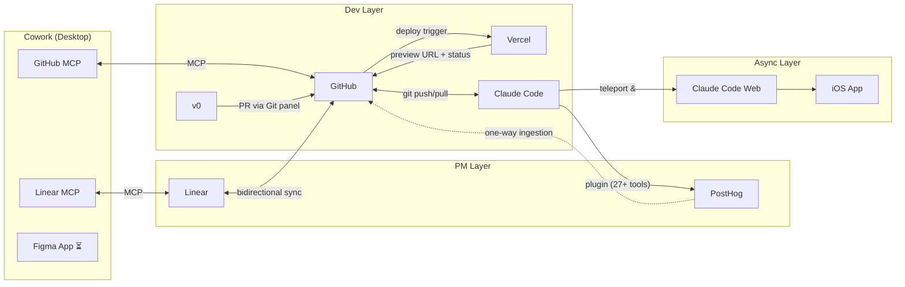

# PM + Dev Workflow Playbook

> **Version 2.0** | 5 Feb 2026
> Supersedes: `pm-dev-workflow-options.md`
> Context: Claude Code v2.1.32, Agent Teams research preview, GitHub Copilot coding agent, v0 platform rebuild, Claude Apps launch

## 1. Executive Summary

This playbook defines the end-to-end PM-to-Dev workflow for all repositories. It is **repo-agnostic**: tool decisions (PostHog, Linear, Vercel, v0) apply globally.

**Core flow:**
```
Ideation (Cowork) -> Analytics (PostHog) -> Spec Draft (Linear) -> Adversarial Review (GitHub) -> Visual Prototype (v0) -> Implementation (Claude Code) -> Verification (Vercel + PostHog) -> Async Handoff (Teleport)
```

**Three approval gates:**
1. Approve spec (after Cowork drafting) — `spec:draft` -> `spec:ready`
2. Approve review findings (after adversarial review)
3. Approve implementation PR (after coding)

**Four review mechanism options** (A-D) can be mixed and matched. Start with **Option A** ($0 additional cost).

---

## 2. Background & Decisions Made

**Goal:** End-to-end workflow from spec drafting (PM) through adversarial review to implementation (Dev) with minimal human intervention. Interaction only at approval gates.

**Constraints:**
- No custom scripts or hooks for automation
- Minimal terminal usage (terminal only where required)
- Anthropic-only models acceptable
- Claude Max 20x ($200/mo) budget
- GitHub Pro (student, free Copilot Pro — 300 premium requests/mo, 3,000 Actions min/mo)
- Willing to consider Pro+ ($39/mo) if optimal
- Unused OpenAI API credits available (Codex agent option)

**Tool decisions (v2.0):**
- **PostHog** selected as analytics platform (over Amplitude) — see Section 9
- **v0** adopted for visual prototyping — see Section 11
- **Cowork-first PM** approach — draft specs in Cowork, push to Linear/GitHub
- **PR merge trigger** standardised for all review automation (not push)

---

## 3. Key Announcements (Feb 3-5 2026)

### Claude Opus 4.6 in GitHub Copilot
- Available to Copilot Pro, Pro+, Business, Enterprise
- Selectable in VS Code, github.com, GitHub Mobile, GitHub CLI
- Excels at agentic coding, planning, and tool calling

### Claude & Codex as Third-Party Coding Agents
- **Pro+ and Enterprise only** (not free Copilot Pro)
- Assign issues directly to `@claude` or `@codex`
- Each session = 1 premium request
- No additional subscriptions required

### GitHub Copilot Coding Agent (Native)
- Available to **all Copilot plans including Pro (student free)**
- Runs autonomously in GitHub Actions environment
- Uses Claude Sonnet 4.5 by default (model selectable for Pro/Pro+)
- Costs: 1 premium request per session + Actions minutes
- Assign issues to `@copilot`

### Claude Code v2.1.32
- Native auto-memory (replaces most claude-flow use cases)
- Subagent persistent memory (`user`/`project`/`local` scopes)
- Automatic skill loading from `--add-dir` directories

### Teleport (`&` Prefix)
- Dispatches tasks from terminal to Claude Code Web (cloud)
- Monitor on iOS app and web
- `/teleport` command pulls web sessions back to terminal (one-way: web -> terminal)
- **Limitations:** GitHub repos only, clean git state, same account, branch must be pushed
- Research preview — shares rate limits with local session

### Agent Teams (Research Preview)
- Independent context windows per agent (unlike subagents which share parent context)
- Parallel work with coordination between agents
- Mixed models: each agent can use `haiku` (fast/cheap), `sonnet` (balanced), or `opus` (most capable)
- Terminal-focused, enabled via `settings.json`
- **Status:** Research preview as of Feb 5 2026 — not production-ready

### v0 Platform Rebuild (Feb 3 2026)
- Rebuilt as production platform (not just prototyping)
- Built-in Git panel: branches, commits, PRs directly from v0
- Can import existing GitHub repos
- Full Platform API at `api.v0.dev` with SDK (`v0-sdk` on npm, v0.16.1)
- Community MCP server available (`v0-mcp-server` on npm)
- No official Vercel v0 MCP server yet

### Claude Apps (MCP Apps)
- Interactive third-party UIs in claude.ai web/desktop chat
- 9 launch partners: **Amplitude, Asana, Box, Canva, Clay, Figma, Hex, monday.com, Slack**
- Built on MCP Apps protocol (`ui://` scheme, sandboxed iframes, JSON-RPC over postMessage)
- **NOT yet available in Cowork** — "coming soon"
- PostHog does NOT have a Claude App; Amplitude and Figma do

### Linear MCP for Product Management (Feb 5 2026)
- SSE endpoint deprecated — migrate from `mcp.linear.app/sse` to `mcp.linear.app/mcp`
- `mcp-remote` stdio wrapper no longer needed — Claude Code supports native HTTP MCP
- Recommended config: `"type": "http", "url": "https://mcp.linear.app/mcp"`
- New capabilities: initiative management, initiative updates, project milestones, project updates, project labels, image loading
- Better tool documentation for reduced token usage
- Broader URL-based resource access
- **Impact:** Enhances Cowork PM funnel (Stage 3) with richer initiative/milestone tools

### Subagent Model Mixing
- Each subagent can specify: `haiku` (cheapest, fastest), `sonnet` (balanced), `opus` (most capable)
- Enables cost optimisation within a single session
- Example: haiku for file scanning, sonnet for review, opus for synthesis

---

## 4. Tool Integration Map

### Diagram



### Sync Direction Table

| Source | Target | Direction | Mechanism | Status |
|--------|--------|-----------|-----------|--------|
| Linear | GitHub | **Bidirectional** | Native sync (issues, PRs, status, labels) | Active |
| GitHub | Vercel | GitHub->Vercel (deploy), Vercel->GitHub (preview URL) | GitHub App | Active |
| v0 | GitHub | One-way (PR creation) | Built-in Git panel | Available |
| GitHub | Claude Code | Bidirectional | git push/pull | Active |
| PostHog | App | One-way (JS SDK ingests events) | posthog-js | Setup needed |
| PostHog | Claude Code | One-way (query) | Claude Code plugin | Setup needed |
| Figma | Cowork | Interactive (FUTURE) | Claude App (MCP Apps) | Coming soon |
| Claude Code | Claude Code Web | One-way dispatch | Teleport (`&`) | Available |

---

## 5. Bidirectional Sync Architecture

### Linear <-> GitHub (Bidirectional)
- Issue created in Linear -> auto-creates GitHub issue (configurable)
- PR merged in GitHub -> updates Linear issue status
- PR linked to Linear issue -> visible in Linear sidebar
- Linear status change -> reflected in GitHub issue labels
- **Config:** Native integration, enabled for alteri repo
- **Caveat:** Label mapping requires manual configuration

### GitHub -> Vercel (Deploy + Preview)
- Push to branch -> triggers Vercel build
- PR opened -> creates preview deployment
- Vercel posts preview URL as PR comment
- Deployment status check blocks/allows merge

### v0 -> GitHub -> Claude Code
- v0 creates branch + PR via built-in Git panel
- Claude Code checks out branch: `git fetch && git checkout <v0-branch>`
- Claude Code implements business logic behind v0 visual skeleton
- Claude Code pushes to same branch, v0 PR updated automatically

### PostHog (One-way)
- App events ingested via posthog-js SDK
- PostHog data warehouse can ingest GitHub data (issues, PRs, commits) for analytics
- Does NOT push data back to GitHub or Linear
- Analysis via PostHog dashboard or Claude Code plugin

### Memory Flows
- **claude-flow memory:** Shared across Code and Desktop (same SQLite DB at `~/.swarm/memory.db`)
- **Native auto-memory (v2.1.32):** Per-session within Claude Code
- **Copilot Memory (Preview):** Separate, GitHub-scoped

---

## 6. Workflow Funnel

### Stage Overview

| # | Stage | Environment | Tools | Gate |
|---|-------|-------------|-------|------|
| 1 | Ideation | Cowork | Figma App (FUTURE), Linear MCP | None |
| 2 | Analytics Review | Claude Code | PostHog plugin | None (informational) |
| 3 | Spec Draft | Cowork -> Linear | Linear MCP, push `spec:draft` | **Human: approve -> `spec:ready`** |
| 4 | Adversarial Review | GitHub Actions / Code | Options A-D | **Human: accept findings** |
| 5 | Visual Prototype | v0 | v0 Git panel -> GitHub PR | None (starting point) |
| 6 | Implementation | Claude Code | Subagents, Agent Teams, Teleport | **Human: review PR** |
| 7 | Verification | Vercel + PostHog | Preview deploy, analytics check | Merge -> production |
| 8 | Async Handoff | Claude Code Web | Teleport (`&`), iOS monitoring | N/A |

### Stage Details

**Stage 1: Ideation** `[Cowork]`
- Interactive spec drafting in Cowork Desktop
- Query Linear for current sprint/cycle issues (`/pm:sync`)
- Research subagents (haiku model, background) for discovery
- Figma Claude App for design context (FUTURE — when Apps reach Cowork)
- **Output:** Draft spec text

**Stage 2: Analytics Review** `[Claude Code]`
- PostHog Claude Code plugin queries user behaviour data
- Session replay analysis, funnel metrics, feature flag data
- Data-informed prioritisation: which features have user signal?
- **Output:** Analytics context appended to spec or Linear comment

**Stage 3: Spec Draft** `[Cowork -> Linear]`
- Finalise spec in Cowork session
- Push to Linear as `spec:draft` issue via Linear MCP
- Set project (Alteri / Claude Infra DevOps / Prototype)
- Add labels: execution mode (`exec:quick`, `exec:tdd`, etc.), environment (`env:desktop`, `env:terminal`)
- Add spec frontmatter:
  ```yaml
  ---
  linear: CIA-XXX
  exec: quick|tdd|swarm|checkpoint|pair
  env: desktop|terminal
  status: ready
  ---
  ```
- **Gate:** Human reviews spec, changes label to `spec:ready`

**Stage 4: Adversarial Review** `[GitHub]`
- Spec pushed to `docs/specs/` via PR, triggers review on **merge** (standardised trigger)
- Review mechanism per Options A-D (see Section 7)
- Three review perspectives: Challenger, Security, Devil's Advocate
- Synthesiser creates consolidated findings
- **Gate:** Human reviews findings, accepts/rejects/revises

**Stage 5: Visual Prototype** `[v0]`
- Open spec's GitHub repo in v0 (import if needed)
- Create component prototypes for UI-heavy specs
- v0 creates PR via built-in Git panel
- **Output:** PR with component visual implementation (skeleton)
- **Note:** Skip this stage for non-UI specs

**Stage 6: Implementation** `[Claude Code]`
- Claude Code pulls spec + review findings + v0 PR (if applicable)
- Execution mode from spec frontmatter determines approach
- Model mix: haiku (scanning), sonnet (review synthesis), opus (implementation)
- Teleport (`&`) for tasks >30 min
- Agent Teams (terminal) for multi-file parallel work
- **Gate:** Human reviews implementation PR

**Stage 7: Verification** `[Vercel + PostHog]`
- Vercel auto-deploys preview on PR push
- Preview URL posted as PR comment — click to verify visually
- PostHog validates analytics instrumentation on preview
- Run automated checks (typecheck, test, lint per `spec-ready-swarm.yml`)
- **Gate:** Merge PR -> production deployment

**Stage 8: Async Handoff** `[Claude Code Web]`
- For any stage that takes >30 min: dispatch via Teleport (`&`)
- Monitor on iOS app or web browser
- Useful for: overnight implementation, batch operations, long reviews
- **Limitations:** GitHub repos only, clean git state, branch must be pushed

---

## 7. Review Options (A-D)

### 7.1 Option A: Fully Free Adversarial Review (Copilot Pro Student)

**Cost: Claude Max 20x ($200/mo) + $0 for review automation**

**How it works:**
1. Cowork drafts spec, writes to `docs/specs/` via PR
2. GitHub Action triggers **on PR merge**, creates 3 review issues auto-assigned to `@copilot`
3. Copilot coding agent picks up each issue, creates draft PRs with findings
4. You review the 3 PRs, approve/request changes
5. Claude Code implements spec incorporating review findings

**Workflow:**
```
Cowork         GitHub Actions        Copilot Agent       You          Claude Code
  |                 |                      |               |               |
  |-- merge spec -->|                      |               |               |
  |                 |-- create 3 issues -->|               |               |
  |                 |                      |-- work x3 --> |               |
  |                 |                      |-- 3 PRs ----> |               |
  |                 |                      |               |-- approve --> |
  |                 |                      |               |              |-- implement
  |                 |                      |               |              |-- PR
  |                 |                      |               |<-- review ---|
```

**GitHub Action: `.github/workflows/create-spec-reviews.yml`**
```yaml
name: Create Spec Review Issues
on:
  push:
    paths: ['docs/specs/**/*.md']
    branches: ['main']  # Only on merge to main

jobs:
  create-reviews:
    runs-on: ubuntu-latest
    steps:
      - uses: actions/checkout@v4

      - name: Get changed spec files
        id: specs
        run: |
          echo "files=$(git diff --name-only HEAD~1 -- docs/specs/)" >> $GITHUB_OUTPUT

      - name: Create challenger review issue
        uses: actions/github-script@v7
        with:
          script: |
            await github.rest.issues.create({
              owner: context.repo.owner,
              repo: context.repo.repo,
              title: `Spec Review: Challenger - ${process.env.SPEC_FILES}`,
              body: `## Challenger Review\n\nReview the following spec(s) as an adversarial challenger. Find gaps, ambiguities, contradictions, and unstated assumptions. Be thorough and adversarial.\n\nFiles: ${process.env.SPEC_FILES}`,
              assignees: ['copilot'],
              labels: ['spec-review', 'challenger']
            });
        env:
          SPEC_FILES: ${{ steps.specs.outputs.files }}

      - name: Create security review issue
        uses: actions/github-script@v7
        with:
          script: |
            await github.rest.issues.create({
              owner: context.repo.owner,
              repo: context.repo.repo,
              title: `Spec Review: Security - ${process.env.SPEC_FILES}`,
              body: `## Security Review\n\nReview the following spec(s) for security implications. Identify attack vectors, data handling risks, privacy concerns, and compliance gaps.\n\nFiles: ${process.env.SPEC_FILES}`,
              assignees: ['copilot'],
              labels: ['spec-review', 'security']
            });
        env:
          SPEC_FILES: ${{ steps.specs.outputs.files }}

      - name: Create devil's advocate issue
        uses: actions/github-script@v7
        with:
          script: |
            await github.rest.issues.create({
              owner: context.repo.owner,
              repo: context.repo.repo,
              title: `Spec Review: Alternative Approaches - ${process.env.SPEC_FILES}`,
              body: `## Devil's Advocate\n\nChallenge the fundamental approach of the following spec(s). Propose completely different alternatives. Question core assumptions.\n\nFiles: ${process.env.SPEC_FILES}`,
              assignees: ['copilot'],
              labels: ['spec-review', 'alternative']
            });
        env:
          SPEC_FILES: ${{ steps.specs.outputs.files }}
```

**Labels needed:** `spec-review`, `challenger`, `security`, `alternative`

**Integration notes:**
- v0 feedback: v0 creates PR -> Copilot reviews visual implementation alongside spec
- Teleport: N/A (review runs in GitHub Actions)
- Agent Teams: N/A
- PostHog: Include analytics data in spec body for Copilot to reference

**Tradeoffs:**

| Pro | Con |
|-----|-----|
| Zero additional cost | Copilot agent (not Claude directly) does the review |
| Fully automated trigger | Model is Sonnet 4.5 (not Opus) |
| Uses included premium requests (300/mo) | Cannot assign to `@claude` — only `@copilot` |
| Uses included Actions minutes (3,000/mo) | Less control over review prompts |
| No API keys needed | 300 premium req limit shared with Copilot Chat |

**Budget:** $200/mo total

---

### 7.2 Option B: GitHub Pro+ with Claude Agent ($39/mo upgrade)

**Cost: $239/mo ($200 Claude Max + $39 Pro+)**

Same as Option A but:
- Assign issues directly to `@claude` (not just `@copilot`)
- 1,500 premium requests/month instead of 300
- Can also use `@codex` (OpenAI) for additional perspectives

**Changes from Option A:**
1. GitHub Action assigns to `['claude']` instead of `['copilot']`
2. Enable Claude agent in Copilot settings > Coding agent > Partner Agents
3. Optionally add `@codex` as a 4th reviewer:

```yaml
- name: Create Codex feasibility review
  uses: actions/github-script@v7
  with:
    script: |
      await github.rest.issues.create({
        owner: context.repo.owner,
        repo: context.repo.repo,
        title: `Spec Review: Implementation Feasibility - ${process.env.SPEC_FILES}`,
        body: `## Implementation Feasibility (Codex)\n\nReview the spec for implementation feasibility. Identify complexity, estimate effort, flag potential technical debt, and suggest simpler alternatives.\n\nFiles: ${process.env.SPEC_FILES}`,
        assignees: ['codex'],
        labels: ['spec-review', 'feasibility']
      });
```

**Integration notes:**
- v0 feedback: v0 creates PR -> Claude reviews (higher quality than Copilot)
- Teleport: N/A (review runs in GitHub Actions)
- Agent Teams: N/A
- PostHog: Include analytics data in spec body for Claude/Codex to reference
- Multi-model: Claude (Anthropic) + Codex (OpenAI) = true multi-model adversarial review

**Tradeoffs:**

| Pro | Con |
|-----|-----|
| Claude as dedicated agent (better quality) | +$39/mo |
| 1,500 premium requests (5x more headroom) | Student discount may not apply to Pro+ |
| Multi-model review (Claude + Codex) | Marginal improvement over Copilot agent |
| `@claude` and `@codex` addressable in PR comments | More moving parts |

**Budget:** $239/mo total

---

### 7.3 Option C: Anthropic API + GitHub Actions

**Cost: ~$220-280/mo ($200 Claude Max + API costs)**

Uses `anthropics/claude-code-action@v1` with Anthropic API key. Three parallel reviewer jobs + synthesiser.

**GitHub Action: `.github/workflows/adversarial-spec-review.yml`**
```yaml
name: Adversarial Spec Review
on:
  push:
    paths: ['docs/specs/**/*.md']
    branches: ['main']  # Only on merge to main

jobs:
  challenger:
    runs-on: ubuntu-latest
    steps:
      - uses: anthropics/claude-code-action@v1
        with:
          anthropic_api_key: ${{ secrets.ANTHROPIC_API_KEY }}
          prompt: |
            You are a Spec Challenger. Review every changed file in docs/specs/.
            Find gaps, ambiguities, missing requirements, contradictions, and
            unstated assumptions. Be adversarial. Create an issue titled
            "Spec Review: Challenger Findings" with your analysis.
          claude_args: "--model claude-opus-4-6 --max-turns 15"

  security-reviewer:
    runs-on: ubuntu-latest
    steps:
      - uses: anthropics/claude-code-action@v1
        with:
          anthropic_api_key: ${{ secrets.ANTHROPIC_API_KEY }}
          prompt: |
            You are a Security Reviewer. Review every changed file in docs/specs/.
            Identify security implications, privacy concerns, attack vectors,
            data handling risks, and compliance considerations. Create an issue
            titled "Spec Review: Security Findings" with your analysis.
          claude_args: "--model claude-opus-4-6 --max-turns 15"

  devils-advocate:
    runs-on: ubuntu-latest
    steps:
      - uses: anthropics/claude-code-action@v1
        with:
          anthropic_api_key: ${{ secrets.ANTHROPIC_API_KEY }}
          prompt: |
            You are a Devil's Advocate. Review every changed file in docs/specs/.
            Argue that the entire approach is wrong. Propose fundamentally
            different alternatives. Challenge the core assumptions. Create an
            issue titled "Spec Review: Alternative Approaches" with your analysis.
          claude_args: "--model claude-opus-4-6 --max-turns 15"

  synthesiser:
    needs: [challenger, security-reviewer, devils-advocate]
    runs-on: ubuntu-latest
    steps:
      - uses: anthropics/claude-code-action@v1
        with:
          anthropic_api_key: ${{ secrets.ANTHROPIC_API_KEY }}
          prompt: |
            Three reviewers have analysed the specs in docs/specs/.
            Read the three most recent issues titled "Spec Review: *".
            Synthesise their findings into a single consolidated review.
            Categorise by: Critical (must address), Important (should address),
            and Consider (nice to have). Create a PR that adds a
            docs/specs/reviews/ file with the consolidated findings.
          claude_args: "--model claude-opus-4-6 --max-turns 20"
```

**Integration notes:**
- v0 feedback: v0 PR can be included in review scope by adjusting paths trigger
- Teleport: N/A (review runs in GitHub Actions)
- Agent Teams: N/A
- PostHog: Include analytics data in API prompt for richer context

**Tradeoffs:**

| Pro | Con |
|-----|-----|
| Full Claude Code (not Copilot agent) | Requires Anthropic API key + pay-per-use |
| Opus 4.6 for all reviewers | ~$2-8 per spec review |
| Most powerful prompting (claude_args) | Separate billing to track |
| Synthesiser auto-creates consolidated PR | More configuration |
| True parallel execution | API costs can accumulate |

**Budget:** ~$220-280/mo total

---

### 7.4 Option D: In-Session Subagents (No Automation)

**Cost: $200/mo (Claude Max only)**

Run adversarial review inside Claude Code using subagents, triggered manually.

```
# In Claude Code after spec is ready:
"Run adversarial review on docs/specs/new-feature.md — launch 3 parallel
subagents as challenger, security reviewer, and devil's advocate using
opus model, then synthesise findings into a review document"
```

**Integration notes:**
- v0 feedback: v0 PR reviewed manually via subagent instruction
- **Teleport:** Yes — dispatch long reviews via `&` and monitor on iOS
- **Agent Teams:** Yes — richer coordination with independent context per reviewer (terminal, experimental)
- PostHog: Query PostHog plugin during review for data-informed analysis
- Model mix: haiku (scanning spec), sonnet (individual reviews), opus (synthesis)

**Tradeoffs:**

| Pro | Con |
|-----|-----|
| Zero additional cost or config | Manual trigger required |
| Uses Max subscription (included) | Eats into Max rate limits |
| Can use Agent Teams (terminal) | Agent Teams = experimental, terminal only |
| Flexible prompting and model mixing | No automation |
| Teleport for async long reviews | Context-heavy (subagents share session context) |

**Budget:** $200/mo total

---

### 7.5 Comparison Matrix

| Dimension | A: Copilot Free | B: Pro+ Claude | C: API Actions | D: Subagents |
|-----------|----------------|----------------|----------------|--------------|
| **Monthly cost** | $200 | $239 | $220-280 | $200 |
| **Automation** | Full | Full | Full | Manual trigger |
| **Review model** | Sonnet 4.5 | Claude (selectable) | Opus 4.6 | Opus (selectable) |
| **Multi-model** | No | Yes (Claude + Codex) | No (Claude only) | No |
| **Config needed** | 1 GH Action + labels | 1 GH Action + enable agent | 1 GH Action + API key | None |
| **Terminal needed** | No | No | No | Optional (Agent Teams) |
| **Premium requests** | 3/review (of 300/mo) | 3/review (of 1,500/mo) | 0 (API separate) | 0 (Max sub) |
| **Hands-off score** | 9/10 | 9.5/10 | 10/10 | 6/10 |
| **Review quality** | Good | Very good | Best | Very good |
| **Setup effort** | Low | Low | Medium | Zero |
| **Teleport handoff** | N/A (GitHub-hosted) | N/A (GitHub-hosted) | N/A (GitHub-hosted) | Yes (`&` dispatch) |
| **Agent Teams** | No | No | No | Yes (experimental) |
| **Model mix** | Sonnet 4.5 (fixed) | Claude + Codex | Opus 4.6 (configurable) | haiku/sonnet/opus per agent |
| **v0 feedback loop** | v0 PR -> Copilot reviews | v0 PR -> Claude reviews | v0 PR triggers API review | v0 PR -> subagent review |
| **PostHog integration** | Data in spec body | Data in spec body | Data in API prompt | Plugin in-session |
| **Cowork compatibility** | Trigger from Cowork | Trigger from Cowork | Trigger from Cowork | Runs IN Code |

---

## 8. Hybrid Combinations

### Combo 1: Option A + Teleport
- Use Copilot agent for automated review (free)
- Teleport long-running **implementation** to Claude Code Web via `&`
- Monitor review results + implementation progress on iOS
- **Cost:** $200/mo, fully async
- **Best for:** Hands-off workflow, mobile-friendly monitoring

### Combo 2: Option D + Agent Teams
- In-session subagent adversarial review with independent context per reviewer
- Mixed models: haiku reviewer (fast, cheap) + opus synthesiser (thorough)
- Terminal required for Agent Teams
- **Cost:** $200/mo, most flexible
- **Best for:** Power users, deep review, experimental features
- **Caveat:** Agent Teams is research preview — expect rough edges

### Combo 3: v0 + Any Option
- v0 creates visual prototype PR
- Whichever review option (A-D) reviews both the spec AND the v0 PR
- Claude Code then enriches v0 skeleton with business logic
- **Pipeline:** v0 PR -> adversarial review -> Claude Code implementation -> Vercel preview
- **Best for:** UI-heavy features

### Combo 4: Cost-Optimised Model Mix
Use different models for different task types within a session:

| Task | Recommended Model | Rationale |
|------|-------------------|-----------|
| File scanning, research | haiku | Cheapest, fastest |
| Review synthesis | sonnet | Balanced quality/cost |
| Critical implementation | opus | Highest quality |
| PostHog queries | haiku | Simple data retrieval |
| Adversarial review | opus | Needs analytical depth |
| Spec drafting assistance | sonnet | Good enough for drafts |

**Estimated savings:** 30-50% vs all-opus, depending on task mix.

### Combo 5: Cowork-First Pipeline
- All PM work starts in Cowork (Desktop)
- Linear MCP for issue management
- GitHub MCP for repo awareness
- Figma App for design context (FUTURE — when Apps reach Cowork)
- Push spec to Linear -> syncs to GitHub -> merge to `docs/specs/` triggers review
- Only switch to Code tab or terminal for implementation
- **Best for:** PM-heavy phases, research sprints

---

## 9. Decision: PostHog as Analytics Platform

### 9.1 Rationale

PostHog wins over Amplitude for solo/small team context:

| Aspect | PostHog | Amplitude |
|--------|---------|-----------|
| Free events/mo | 1M | 10M |
| Session replay (free) | 5K sessions | Included |
| Feature flags | Yes (1M API req) | Yes |
| A/B testing | Yes | Yes |
| Surveys | Yes (250/mo) | No |
| Heatmaps | Yes (5K sessions) | No |
| Open source | Yes (MIT) | No |
| Self-hostable | Yes | No |
| Claude Code plugin | **Yes (27+ tools)** | No |
| Claude App (chat UI) | No | Yes |
| Claude App in Cowork | N/A (not yet) | N/A (not yet) |

**Verdict:** PostHog bundles more at the free tier, has better CLI/developer integration (Claude Code plugin), and is open source. Amplitude's Claude App advantage is moot — Apps aren't in Cowork yet.

### 9.2 Free Tier Coverage

| Feature | Free Tier Limit | Expected Usage | Adequate? |
|---------|----------------|----------------|-----------|
| Events | 1M/month | <100K | Yes |
| Session replay | 5K sessions/month | <1K | Yes |
| Feature flags | Unlimited | <10 flags | Yes |
| A/B testing | 1M tested users | <100 | Yes |
| Surveys | 250 responses/month | <50 | Yes |
| Heatmaps | 5K sessions/month | <1K | Yes |

### 9.3 Integration Points

- **Stage 2 (Analytics Review):** PostHog Claude Code plugin queries user data
- **Stage 7 (Verification):** PostHog validates analytics instrumentation on Vercel preview
- **App instrumentation:** `posthog-js` SDK in Next.js apps
- **Data export:** One-way from app to PostHog data warehouse

### 9.4 Claude Code Plugin Capabilities
- Query events, funnels, retention
- Analyse session replays
- Manage feature flags
- Run experiments
- Access data warehouse
- **Note:** Plugin works in Claude Code only, not in Cowork/Desktop

### 9.5 Path to Claude App
- Watch PostHog changelog for Claude App announcement
- When available: integrate into Cowork for PM analytics dashboard
- Alternative (lower priority): custom MCP server wrapping PostHog API
- **Current mitigation:** Use Claude Code plugin in Code tab, paste insights into Cowork spec

---

## 10. Cowork Integration Roadmap

### Available Now

| Tool | Mechanism | What It Enables |
|------|-----------|-----------------|
| Linear | MCP (HTTP, OAuth) | Issues, labels, initiatives, milestones, projects, documents |
| GitHub | MCP (stdio, PAT) | Read repos, create PRs, manage issues |
| claude-flow | MCP (stdio, local) | Cross-session memory, vector search (Terminal only) |
| Vercel | HTTP (OAuth) | Project management, deployment status |

### Coming Soon: Claude Apps in Cowork

Claude Apps currently work in web/chat only. "Coming soon" for Cowork.

### What This Unlocks

| Claude App | PM Capability in Cowork |
|------------|------------------------|
| Figma | Design review with interactive UI, annotation, component inspection |
| Amplitude | Analytics dashboards (or PostHog if they build one) |
| Slack | Notification management, team communication |
| Canva | Marketing asset creation for research dissemination |
| Asana / monday.com | Alternative PM views (not needed if Linear is primary) |

### Recommended Cowork PM Session Pattern (Today)

1. Open Cowork session
2. Query Linear for current sprint/cycle issues (`/pm:sync`)
3. Draft or refine spec interactively
4. Push spec to Linear as `spec:draft` using Linear MCP
5. Switch to Code tab for PostHog analytics context (plugin)
6. Return to Cowork, incorporate analytics insights
7. Approve spec, update label to `spec:ready`
8. Push spec file to `docs/specs/` via GitHub MCP -> merge triggers review

---

## 11. v0 Visual Prototyping Integration

### What v0 Is (Feb 2026)
- Production platform (rebuilt Feb 3 2026)
- Built-in Git panel: branches, commits, PRs directly from v0
- Can import existing GitHub repos
- Full Platform API at `api.v0.dev`
- Official SDK: `v0-sdk` (npm, v0.16.1)
- Community MCP server: `v0-mcp-server` (npm, v1.0.4) — add to `~/.mcp.json`
- No official Vercel v0 MCP server yet

### MCP Setup

Add to `~/.mcp.json`:
```json
{
  "v0": {
    "command": "npx",
    "args": ["-y", "v0-mcp-server"]
  }
}
```

**Note:** This is a community package (`v0-mcp-server` by BenAHammond). Monitor for official Vercel MCP when available.

### Bridge to Claude Code

Best handoff pattern:
1. v0 creates visual component implementation
2. v0 pushes to branch via built-in Git panel
3. v0 opens PR to GitHub
4. Claude Code checks out branch: `git fetch && git checkout <v0-branch>`
5. Claude Code adds business logic, state management, API integration
6. Both commit to same branch — v0 PR updates automatically

### v0 in the Funnel
- Lives at **Stage 5** (Visual Prototyping)
- Input: approved spec (after adversarial review)
- Output: PR with component visual implementations (skeleton)
- Followed by: Claude Code implementation (Stage 6)
- **Skip this stage** for non-UI specs (backend, data, infrastructure)

---

## 12. Teleport & Async Handoff

### What Teleport Is
- `&` prefix in Claude Code dispatches task to cloud (creates new web session)
- `/teleport` command pulls web session back to terminal (one-way: web -> terminal)
- Context carries to cloud session
- Monitor on iOS app and web browser

### Limitations
- GitHub repos only (not local-only repos)
- Clean git state required
- Same account (shares authentication and rate limits)
- Branch must be pushed to remote
- Cannot push existing local session to web — `&` creates a new cloud session

### When to Use

| Scenario | Use Teleport? | Why |
|----------|---------------|-----|
| Long adversarial review (Option D) | Yes | >30 min, monitor on phone |
| Overnight implementation | Yes | Detachable, monitor remotely |
| Batch file operations | Yes | Long-running, non-interactive |
| Quick bug fix | No | Faster locally |
| Spec drafting | No | Interactive, needs Cowork |
| Design review | No | Visual, needs desktop |

### Teleport + Options

| Option | Teleport Applicability |
|--------|----------------------|
| A (Copilot Free) | Review runs in GitHub — teleport useful for **implementation** only |
| B (Pro+ Claude) | Review runs in GitHub — teleport useful for **implementation** only |
| C (API Actions) | Review runs in GitHub — teleport useful for **implementation** only |
| D (Subagents) | Teleport useful for **both review and implementation** |

---

## 13. Tools & Surfaces Reference

| Surface | Auth | Purpose | Cost |
|---------|------|---------|------|
| **Cowork** (Desktop) | Claude Max 20x | Spec drafting, interactive Q&A, PM | Included |
| **Claude Code** (Desktop/Terminal) | Claude Max 20x | Implementation, subagent orchestration | Included |
| **Agent Teams** (Terminal) | Claude Max 20x | Multi-agent coordination (research preview) | Included |
| **Claude Code Web** (Teleport) | Claude Max 20x | Remote sessions, mobile monitoring | Included |
| **Copilot coding agent** | Student Copilot Pro | Autonomous review via GitHub | Free (300 req/mo) |
| **Claude agent** (GitHub) | Copilot Pro+ | Dedicated Claude agent on GitHub | $39/mo |
| **Codex agent** (GitHub) | Copilot Pro+ | Dedicated Codex agent on GitHub | $39/mo |
| **GitHub Actions** | Student Pro | Workflow automation | Free (3,000 min/mo) |
| **GitHub Models** (Preview) | Student Pro | Model API prototyping | Free tier |
| **v0** (Web) | Vercel account | Visual prototyping, PR creation | Free tier |
| **PostHog** | API key / JS SDK | Analytics, session replay, feature flags | Free (1M events/mo) |
| **Figma Claude App** | Figma account | Design review in chat (FUTURE in Cowork) | Free (viewer) |
| **Linear** | OAuth | Issue tracking, PM workflow | Free (team plan) |
| **Vercel** | OAuth | Deployment, preview URLs | Free (Hobby) |

---

## 14. Memory & Context Sharing

| Mechanism | Scope | Status | Notes |
|-----------|-------|--------|-------|
| Native auto-memory (v2.1.32) | Claude Code sessions | Active | Replaces most claude-flow use |
| CLAUDE.md hierarchy | All Claude Code sessions | Active | Global + project-level |
| Subagent persistent memory | Per-subagent, scoped | Available | user/project/local scopes |
| Copilot Memory (Preview) | GitHub Copilot sessions | Enable in settings | Separate from Claude |
| claude-flow MCP | Cross-environment | Active (terminal) | Cowork<->Code bridge |
| PostHog context | Via Claude Code plugin | Setup needed | Query in Code, paste to Cowork |
| v0 context | Via Git branch | Available | No dedicated memory mechanism |
| Teleport context | Serialised to cloud | Available | One-way, new session created |

---

## 15. Recommendation & Upgrade Paths

### Starting Configuration

**Start with Option A** + PostHog (free) + v0 (free) + Vercel (free).

It's zero additional cost, fully automated, and the Copilot coding agent using Sonnet 4.5 is competent for spec review. Your 300 premium requests are ample if used for reviews only.

### Upgrade Ladder

```
Tier 1: $200/mo (Claude Max 20x)
  Option A + PostHog(free) + v0(free) + Vercel(free)
  Best for: getting started, validating workflow

Tier 2: $239/mo (+$39 Copilot Pro+)
  Option B: @claude + @codex agents in GitHub
  Best for: higher review quality, multi-model review

Tier 3: $220-280/mo (+ Anthropic API costs)
  Option C: Full API control, Opus for all reviewers
  Best for: maximum review quality, custom prompts

Flex: $200/mo + in-session flexibility
  Option D + Agent Teams + Teleport
  Best for: power users, terminal-comfortable, experimental
```

### Upgrade Triggers

| Signal | Action |
|--------|--------|
| Copilot reviews miss important issues | Upgrade A -> B (add @claude) |
| Need Opus-quality for all reviews | Upgrade to C (API Actions) |
| Want async mobile monitoring of reviews | Add Teleport to Option D |
| Agent Teams exits research preview | Evaluate D + Teams as primary |
| Claude Apps land in Cowork | Enable Figma App immediately |
| PostHog builds Claude App | Integrate for PM analytics in Cowork |

---

## 16. Implementation Checklists

### Global Tool Setup (All Repos)

- [ ] Create PostHog project at posthog.com
- [ ] Install `posthog-js` SDK in Next.js apps
- [ ] Install PostHog Claude Code plugin (`PostHog/posthog-for-claude`)
- [ ] Import repos into v0 (start with alteri)
- [ ] Add `v0-mcp-server` to `~/.mcp.json` (see Section 11)
- [ ] Verify Vercel deployment connected per repo
- [ ] Verify Linear <-> GitHub bidirectional sync active
- [ ] Create `docs/specs/` directory in each repo
- [ ] Test Teleport: `& echo "teleport test"` from a repo
- [ ] Create Linear tracking issue: "Monitor Claude Apps in Cowork availability"

### Option A Setup (Per Repo)

- [ ] Create labels: `spec-review`, `challenger`, `security`, `alternative`
- [ ] Add `.github/workflows/create-spec-reviews.yml` (see Section 7.1)
- [ ] Verify Copilot coding agent is enabled for repo
- [ ] Test: merge a spec file to `docs/specs/`, verify 3 issues created
- [ ] Verify Copilot picks up issues and creates PRs

### Option B Upgrade (If Needed)

- [ ] All of Option A checklist
- [ ] Upgrade to Copilot Pro+ ($39/mo)
- [ ] Enable Claude and Codex in Copilot coding agent settings
- [ ] Change issue assignees from `['copilot']` to `['claude']` in workflow
- [ ] Add 4th Codex reviewer issue (optional)
- [ ] Add `feasibility` label

### Option C Setup (If Needed)

- [ ] Add `ANTHROPIC_API_KEY` to repo secrets
- [ ] Add `.github/workflows/adversarial-spec-review.yml` (see Section 7.3)
- [ ] Create `docs/specs/reviews/` directory
- [ ] Test: merge a spec, verify 3 review issues + consolidated PR

---

## 17. Appendix: GitHub Billing Tabs

| Tab | What | Your Usage |
|-----|------|-----------|
| **Actions** | CI/CD minutes | 112 / 3,000 min (spec review automation runs here) |
| **Codespaces** | Cloud dev environments | Unused |
| **Copilot** | Premium request overages | Monitor after enabling reviews |
| **Git LFS** | Large file storage | Unused |
| **Models** | GitHub Models API (prototyping) | Separate from Copilot |
| **Packages** | Container/npm registry | Unused |
| **Spark** | AI app builder (preview) | Separate premium requests |
