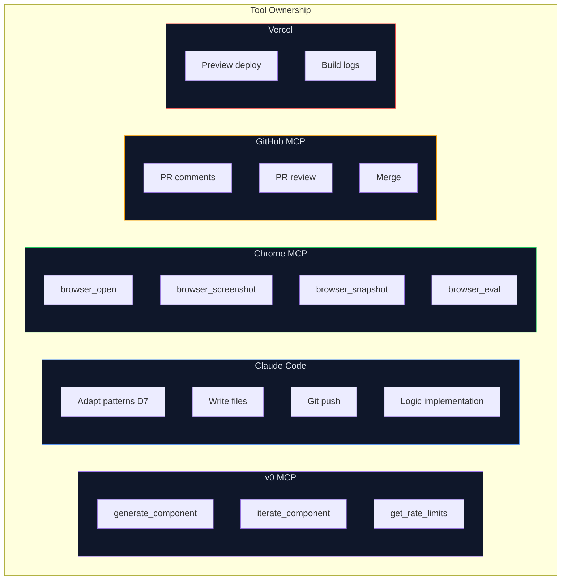
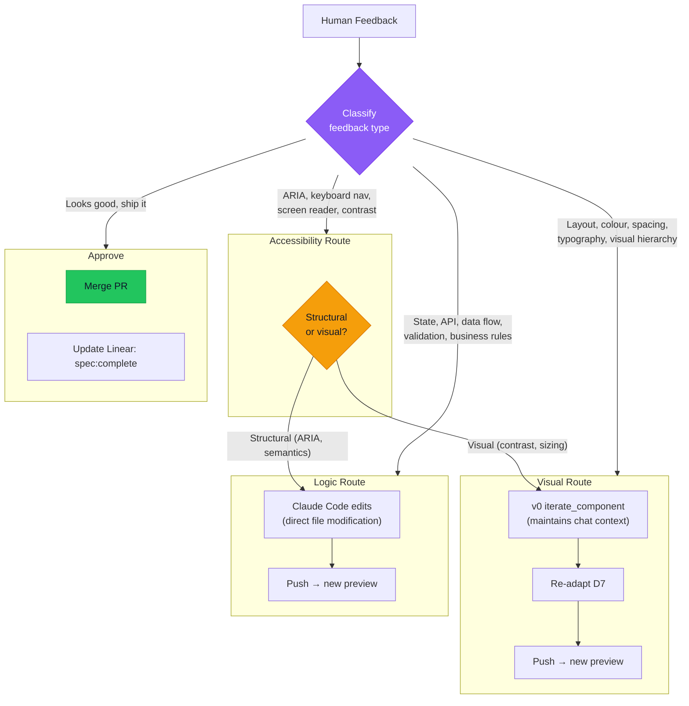
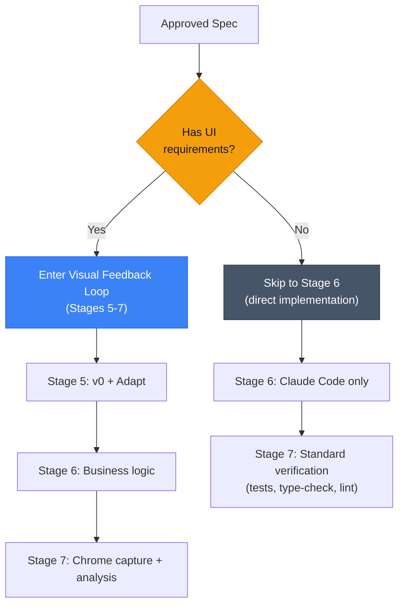

# CIA-259: Visual Feedback Loop — PM-Dev Workflow Integration

## Where the Visual Loop Fits

```mermaid
flowchart LR
    subgraph Ideation ["Stage 1: Ideation"]
        S1[Cowork / Voice memo]
    end

    subgraph Analytics ["Stage 2: Analytics"]
        S2[Evidence gathering]
    end

    subgraph Spec ["Stage 3: PR/FAQ + Spec"]
        S3[Spec draft]
        S3a{Approval<br/>Gate 1}
    end

    subgraph Review ["Stage 4: Adversarial Review"]
        S4[Multi-LLM review]
        S4a{Approval<br/>Gate 2}
    end

    subgraph Visual ["Stage 5: Visual Prototype ★"]
        direction TB
        S5[v0 generate]
        S5a[Adapt D7]
    end

    subgraph Impl ["Stage 6: Implementation ★"]
        S6[Claude Code<br/>business logic]
    end

    subgraph Verify ["Stage 7: Verification ★"]
        direction TB
        S7[Chrome capture]
        S7a[Multimodal analysis]
        S7b{Human<br/>review}
    end

    subgraph Deploy ["Stage 8: Async Handoff"]
        S8[Merge + Deploy]
        S8a{Approval<br/>Gate 3}
    end

    S1 --> S2 --> S3 --> S3a
    S3a -->|Approved| S4 --> S4a
    S4a -->|Approved| S5

    S5 --> S5a --> S6 --> S7 --> S7a --> S7b

    S7b -->|"Visual issue"| S5
    S7b -->|"Logic issue"| S6
    S7b -->|Approved| S8 --> S8a

    style Visual fill:#1e293b,stroke:#3b82f6,stroke-width:3,color:#fff
    style Impl fill:#1e293b,stroke:#3b82f6,stroke-width:3,color:#fff
    style Verify fill:#1e293b,stroke:#3b82f6,stroke-width:3,color:#fff
    style S3a fill:#f59e0b,stroke:#d97706,color:#0f172a
    style S4a fill:#f59e0b,stroke:#d97706,color:#0f172a
    style S7b fill:#8b5cf6,stroke:#7c3aed,color:#fff
    style S8a fill:#f59e0b,stroke:#d97706,color:#0f172a
```

**★ Stages 5-7 form the Visual Feedback Loop sub-cycle defined by CIA-259.**

## Tool Mapping by Stage

## Decision Routing Detail

## Entry Criteria Guard

